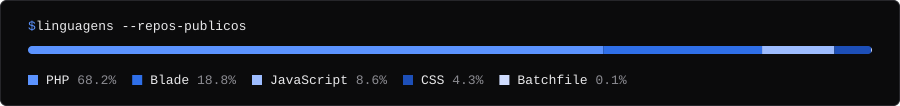

## ~/sobre

Estudo no IFES Campus Colatina e desenvolvo principalmente em PHP (Laravel e PHP puro), JavaScript, C++ e Python.

Meu TCC do curso técnico é o GingaHub, uma plataforma em Laravel para gestão de academias de artes marciais: cadastro de alunos e academias, matrículas, planos e treinos, com validação de CPF e CNPJ (incluindo o novo CNPJ alfanumérico), transações no banco em cadastros que envolvem várias tabelas e sessão que expira sozinha em computadores compartilhados.

Fora do curso, quase tudo que construo nasce de uma necessidade concreta. A Central de Ferramentas, por exemplo, começou como um punhado de scripts Python para gerar documentos da igreja e virou um servidor PHP com editor de .docx e .xlsx no navegador, contas de usuário, backup automático e mais de vinte ferramentas.

Também participo do desenvolvimento do Titãs da Robótica, equipe do IFES Colatina na RoboCup Soccer Simulation 2D, terceira colocada no mundial de 2026. Ali o trabalho é C++ de tomada de decisão e uma regra simples: uma alteração por vez, medida em amostras grandes antes de entrar no time.

## ~/o-que-posso-fazer

| | |
|:--|:--|
| `web` | Sistemas web completos em Laravel (autenticação, regras de negócio, banco relacional) ou em PHP puro quando o projeto pede algo leve, que rode em hospedagem simples ou num XAMPP local. |
| `banco` | Modelagem de banco relacional em MySQL/MariaDB: migrations, integridade, transações e dados que não duplicam. |
| `docs` | Automação de documentos: gerar, preencher e editar .docx e .xlsx a partir de modelos, direto no navegador, sem Office instalado. |
| `processos` | Transformar planilhas e rotinas manuais em ferramentas com login, histórico de versões, lixeira e backup. |
| `c++` | Agentes autônomos e simulação: comportamento, tomada de decisão e avaliação estatística de mudanças. |
| `dados` | Scripts em Python para extrair, tratar e analisar dados e logs. |

## ~/projetos

Boa parte do que já fiz ainda está sendo trazida para o GitHub. Esta lista cresce conforme os projetos chegam.

### Aplicações web e ferramentas

| projeto | o que é | stack | atualizado |
|:--|:--|:--|:--|
| [**Central de Ferramentas**](https://github.com/beraymundo/php_app_srv) <code>php_app_srv</code> | Servidor PHP com editor de .docx/.xlsx no navegador, geração de documentos por modelo, usuários, backup e ferramentas para casa, finanças, estudos e igreja. | PHP · JavaScript · CSS | nov/2026 |

### Fora do GitHub ou privados

| projeto | o que é | stack |
|:--|:--|:--|
| **GingaHub** | TCC do curso técnico: plataforma que conecta alunos e academias de artes marciais, com matrículas, planos e treinos. Desenvolvido em dupla na organização GingaHub-TCC (repositório privado). | Laravel · PHP · MariaDB · Tailwind |
| **Titãs da Robótica 2D** | Time de futebol de robôs simulado (RoboCup 2D), terceiro lugar no mundial de 2026. Código mantido pela equipe em repositório privado. | C++ |

## ~/stack

`PHP` `Laravel` `JavaScript` `Tailwind CSS` `HTML/CSS` `MySQL / MariaDB` `C++` `Python` `Vite` `CMake` `Git` `Docker` `Linux` `XAMPP / Apache`

---

Página gerada a partir de <code>perfil.json</code> e dos repositórios públicos. Novos projetos entram aqui sozinhos.
